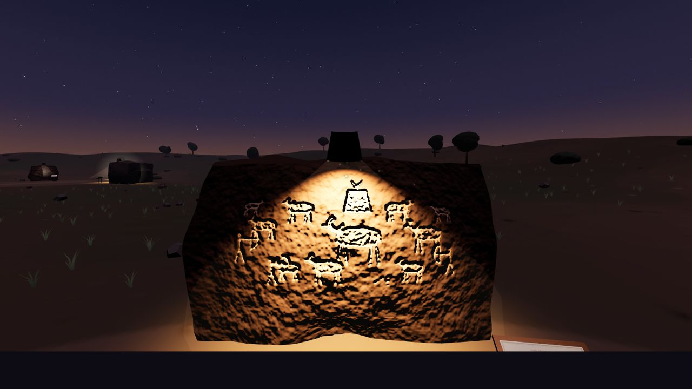
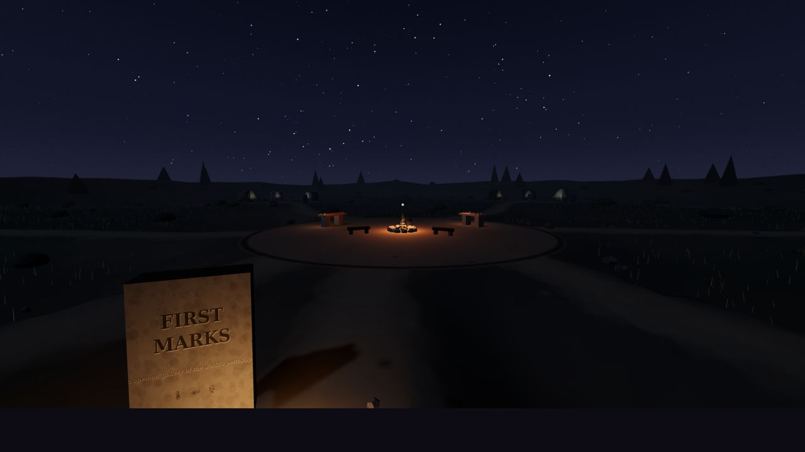
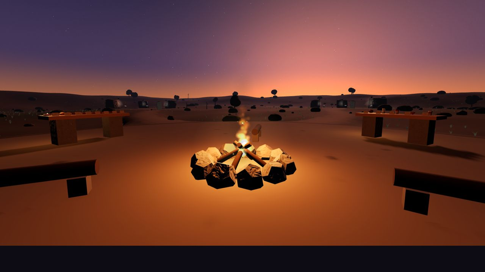
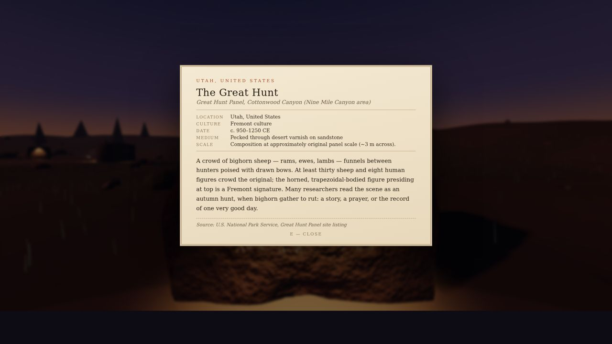
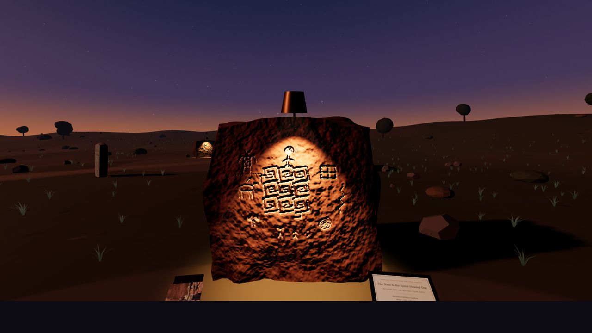

# FIRST MARKS 🪨

*an open-air gallery of the world's petroglyphs*

**Visit: [gallery.brezgis.com](https://gallery.brezgis.com)**



A walkable three.js gallery at perpetual dusk. Twenty-one real petroglyphs —
extracted from openly licensed photographs and drawings by an image-processing
pipeline and carved as thousands of peck marks, at (or near) published scale —
stand on procedurally shaped boulders in six regional
groves, each with a brass gallery sconce and a fact-checked museum label
whose sources are clickable. A seventh grove, **Field Notes**, holds two
panels the curator encountered in person in the Vermilion Cliffs of Arizona,
with her field photographs framed beside them.

At the center: a fire, log benches you can sit on, a pottery bar pouring five
archaeologically attested drinks (9,000-year-old Jiahu rice-honey wine, Chaco
canyon cacao, chicha de jora, pulque, Wari chicha de molle), and a table of
founding foods you can read about, pick up and eat. The score — wooden flute, wind, crickets,
fire — is generated live in WebAudio. Nothing is sampled, no asset files
exist: every texture is drawn in code, every sound synthesized, and the whole
gallery ships as **one self-contained HTML file**.

| | |
|---|---|
|  |  |
|  |  |

## Quickstart

```bash
git clone https://github.com/brezgis/petroglyph-gallery
cd petroglyph-gallery
npm install
npm run dev        # build + serve on http://localhost:8123
```

No build needed just to *visit*: open `docs/index.html` in any browser —
that single file is the entire gallery. `npm run dist` regenerates it.

## Controls

WASD + mouse to walk (Shift or double-tap **W** to run) · **E** read labels /
take pottery or food / sip / take a bite / sit by the fire · **G** set it down ·
**N** dusk ⇄ night · **M** mute · **Q** performance mode · **H** all controls ·
Esc frees the cursor. Labels open short; the fold below each one holds the full
text, details and sources.

On a phone or tablet: left thumb walks (push to the rim to run), right thumb
looks, and on-screen buttons stand in for E, G, N and M.

Worth waiting for: the Sun Dagger returns to the Fajada spiral every few
minutes, shooting stars only fall at night, and there are lizards.

## The collection

- **North America** — the Great Hunt (Nine Mile Canyon) · the Fajada Butte Sun
  Dagger spiral · Three Rivers · the Sand Island flute players
- **South America** — the Toro Muerto dancers · the Atacama llama caravan ·
  the 42-metre serpent of the Orinoco
- **Europe** — Tanum's bronze ships · the Camunian Rose · Alta's reindeer corral
- **Africa** — the Dabous giraffes at their full 5.4 m · the Lion Man of
  Twyfelfontein · the Ice Age aurochs of Qurta
- **Asia** — Tamgaly's sun-headed beings · Gobustan's reed boats · the
  Bangudae whale hunt
- **Oceania** — the Murujuga thylacine · the Emu in the Sky, underfoot ·
  the birdmen of Orongo
- **Field Notes** — the Maze Rock Art Site & an unrecorded herd, Vermilion
  Cliffs, Arizona

## Honesty & ethics

Eighteen of the engravings are extracted from openly licensed images (below);
three — the Murujuga thylacine, Qurta's aurochs and the Orinoco serpent — have
no usable free image and remain respectful hand redrawings. Sources are on
every lectern (UNESCO listings, NPS/BLM pages,
journal DOIs; every label was fact-checked and every link fetch-verified).
The originals belong to their landscapes and to the living peoples whose
heritage they are. The location of the one formally unrecorded panel is
deliberately withheld, per rock-art ethics. If you ever stand before the
real thing: never touch, chalk, or make rubbings.

## Glyph pipeline

The engravings are not drawn by hand any more: `npm run glyphs` rebuilds them
from reference images (Python 3 with `numpy`, `opencv-python-headless` and
`scikit-image` — see `scripts/glyphs/requirements.txt`).

1. **Fetch** — `scripts/glyphs/fetch.py` reads `scripts/glyphs/manifest.json`,
   asks the Wikimedia Commons API for each listed `File:` (URL, author,
   licence) and downloads a ≤2400 px rendition into `reference/glyph-sources/`
   (gitignored). Credits land in `scripts/glyphs/sources.json`. It only ever
   makes plain GETs to `commons.wikimedia.org` / `upload.wikimedia.org`.
2. **Extract** — `scripts/glyphs/extract.py` crops (or perspective-corrects)
   each layer, removes the rock's lighting gradient with a wide Gaussian, then
   thresholds in one of several modes: `light` (pecked marks paler than
   varnish), `dark` (ink drawings), `red` (Scandinavian red in-fill, Lab a\*),
   `chroma` (pale *and* desaturated), `mix`, `smooth` (ground areas with less
   texture), `ridge` (a Sato tube filter for incised line work such as Dabous),
   or `color` (a coloured tracing line). Masks are cleaned (open/close, small
   specks, include/exclude polygons for hand masking), downsampled and
   run-length encoded into the generated `src/art/glyphdata.js`, along with
   the image credits. Where thresholding cannot separate a low-relief carving
   (the Yerbas Buenas llama) the manifest carries a hand-traced outline over
   the photo instead, and the label says so. Debug sheets (source · overlay ·
   mask, plus a whole-panel preview) are written to
   `reference/glyph-sources/debug/` for checking every glyph by eye.
3. **Carve** — `g.mask()` in `src/art/glyphs.js` lays each mask down as a
   soft groove floor and pecks it over with jittered hammer-stone dots; the
   same layer is embossed into the normal map, so the sconce light rakes the
   grooves. Panels with no layers fall back to their hand-drawn `draw()`.

Each lectern card credits the image its engraving came from. Derived masks
are adaptations of those images and are shared under the same licences.

| panel | status | source image (Wikimedia Commons unless noted) |
|---|---|---|
| great-hunt | good | [Day 5- The Great Hunt Panel (20182545315).jpg](https://commons.wikimedia.org/wiki/File:Day_5-_The_Great_Hunt_Panel_(20182545315).jpg) — BLMUtah, Public domain |
| three-rivers | good | [Three Rivers desert bighorn.jpg](https://commons.wikimedia.org/wiki/File:Three_Rivers_desert_bighorn.jpg) — Noahedits, CC BY-SA 4.0<br>[Three Rivers Petroglyphs IMG 20220308 123959.jpg](https://commons.wikimedia.org/wiki/File:Three_Rivers_Petroglyphs_IMG_20220308_123959.jpg) — Ahuka, CC BY-SA 2.0 |
| tanum | good | [Tanum Vitlycke unesco IMG 4754 ships.jpg](https://commons.wikimedia.org/wiki/File:Tanum_Vitlycke_unesco_IMG_4754_ships.jpg) — Bjoertvedt, CC BY-SA 3.0 |
| alta | good | [AltaRockCarvingsFences.jpg](https://commons.wikimedia.org/wiki/File:AltaRockCarvingsFences.jpg) — Uspn at English Wikipedia, CC BY-SA 3.0 |
| fajada | approximated | [Fajadadiagram.JPG](https://commons.wikimedia.org/wiki/File:Fajadadiagram.JPG) — Nationalparks at English Wikipedia, Public domain |
| dabous | good | [Giraffen von Dabous.jpg](https://commons.wikimedia.org/wiki/File:Giraffen_von_Dabous.jpg) — MRF-Freund, CC BY-SA 4.0 |
| sydney-emu | good | [Emu in the Sky with a tracing of the Rock Engraving superimposed.tif](https://commons.wikimedia.org/wiki/File:Emu_in_the_Sky_with_a_tracing_of_the_Rock_Engraving_superimposed.tif) — Barnaby Norris and Ray Norris, CC BY-SA 4.0 |
| twyfelfontein | good | [Twyfelfontein-Gravure rupestre-Girafe et lion.jpg](https://commons.wikimedia.org/wiki/File:Twyfelfontein-Gravure_rupestre-Girafe_et_lion.jpg) — Ji-Elle, CC BY-SA 4.0 |
| sand-island | approximated | [Sand Island Petroglyphs - panoramio.jpg](https://commons.wikimedia.org/wiki/File:Sand_Island_Petroglyphs_-_panoramio.jpg) — runt35, CC BY 3.0 |
| toro-muerto | approximated | [Toro Muerto Petroglyphs, Peru (1972) (457747624).jpg](https://commons.wikimedia.org/wiki/File:Toro_Muerto_Petroglyphs,_Peru_(1972)_(457747624).jpg) — A.Davey from Portland, Oregon, EE UU, CC BY 2.0 |
| atacama-llamas | approximated | [Yerbas Buenas 3.jpg](https://commons.wikimedia.org/wiki/File:Yerbas_Buenas_3.jpg) — ReflectedSerendipity from United Kingdom, CC BY-SA 2.0 |
| valcamonica | good | [Rosa camuna (Foppe).svg](https://commons.wikimedia.org/wiki/File:Rosa_camuna_(Foppe).svg) — RootOfAllLight, CC BY-SA 4.0<br>[Rosa camuna e antropomorfi R24 - Foppe - Nadro.jpg](https://commons.wikimedia.org/wiki/File:Rosa_camuna_e_antropomorfi_R24_-_Foppe_-_Nadro.jpg) — Luca Giarelli, CC BY-SA 3.0 |
| tamgaly | approximated | [Bronze age conception of the world with sun gods, animals and dancing humans at Tangaly, Kazakhstan.jpg](https://commons.wikimedia.org/wiki/File:Bronze_age_conception_of_the_world_with_sun_gods,_animals_and_dancing_humans_at_Tangaly,_Kazakhstan.jpg) — Ken and Nyetta, CC BY 2.0 |
| bangudae | approximated | [Bangudae3.jpg](https://commons.wikimedia.org/wiki/File:Bangudae3.jpg) — Ulsan Petroglyph Museum, CC BY-SA 3.0 |
| orongo | good | [Oc,G.T.1482, Mana Expedition to Easter Island, British Museum.jpg](https://commons.wikimedia.org/wiki/File:Oc,G.T.1482,_Mana_Expedition_to_Easter_Island,_British_Museum.jpg) — Unknown author, Public domain |
| gobustan | good | [Gobustan rock paintings - a boat.jpg](https://commons.wikimedia.org/wiki/File:Gobustan_rock_paintings_-_a_boat.jpg) — M.Ragimov, CC BY-SA 4.0 |
| wp-herd | good | `IMG_2278.jpg` — the curator's own photograph |
| wp-maze | good | `IMG_2350.jpg` — the curator's own photograph |
| murujuga | failed | no openly licensed photo of a Murujuga thylacine engraving on Commons; hand redrawing kept |
| qurta | failed | no openly licensed Qurta photo or tracing on Commons; hand redrawing kept |
| cerro-pintado | failed | no openly licensed photo of the Cerro Pintado serpent on Commons; hand redrawing kept |

## Tech notes

Plain JavaScript + [three.js](https://threejs.org), bundled with esbuild.
Terrain, sky, boulders, pottery and ground are procedural (fBm value noise +
canvas textures); petroglyphs render as thousands of jittered peck-dots over
masks extracted from reference images (see *Glyph pipeline*), embossed into
normal maps so the sconce light catches the grooves. Performance architecture: only the 6 nearest sconce spotlights are
live lights (constant count → no shader rebuilds), shadows re-bake only while
the light moves, resolution adapts to frame time, and raycasts hit invisible
proxy boxes. Grass/terrain techniques after
[al-ro](https://al-ro.github.io/projects/grass/) and the
[Codrops grass tutorial](https://tympanus.net/codrops/2025/02/04/how-to-make-the-fluffiest-grass-with-three-js/).

For checking work headlessly: `?cam=x,y,z,yaw,pitch` renders a still view,
`&panel=<id>` frames one stone (add `&tex=1` to overlay its raw textures),
`&night=0..1` sets the hour and `&live=1` keeps the walker and interactions
running for scripted key presses.

Built by [Claude](https://claude.com/claude-code), with full creative control,
for Anna — who then walked into the desert and brought back two more stones.
